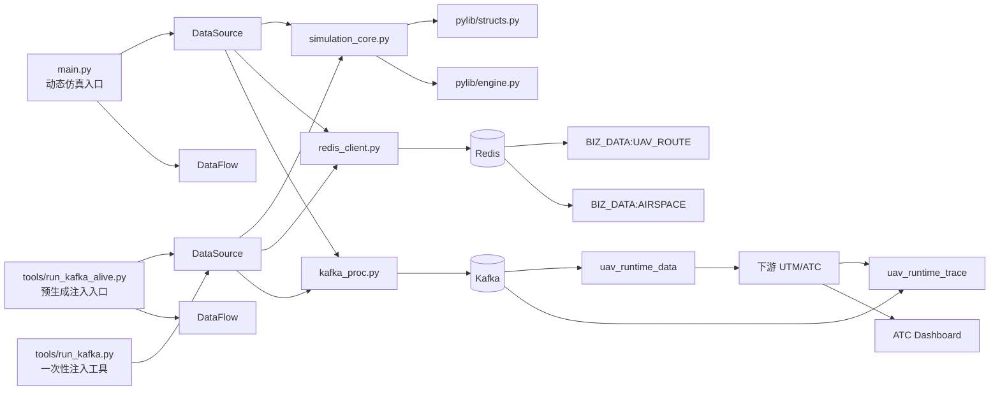
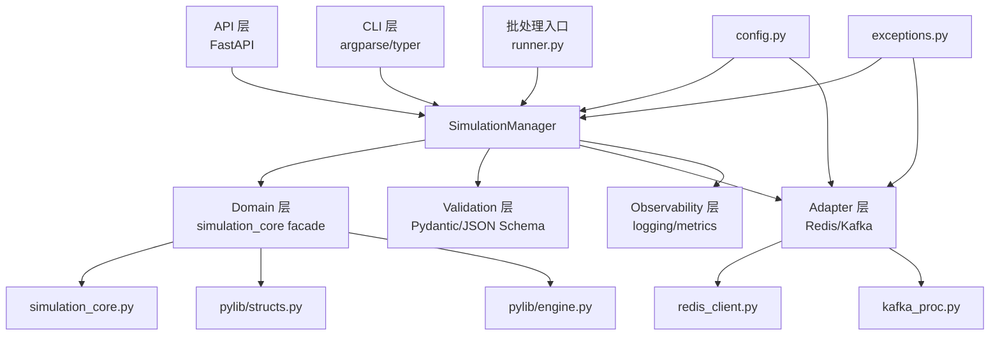
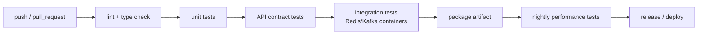

# utm_moc52 重构与测试优化分析报告

执行摘要：utm_moc52 已具备仿真核心、Redis/Kafka 注入与动态/回放双运行模式，但入口重复、配置与日志薄弱、缺乏统一接口与自动化测试。建议以 `SimulationManager` 为中枢，保留成熟仿真资产，分三阶段完成解耦、接口层、测试层与发布治理，首版预计 4–6 周可灰度落地。

## 代码库结构与模块依赖图

基于现有架构文档、核心代码原理、环境配置与已有初步优化方案，utm_moc52 当前可以明确分为四层：业务编排层（`main.py`、`tools/run_kafka_alive.py`、`tools/run_kafka.py`）、仿真核心层（`simulation_core.py`）、数据接入层（`redis_client.py`、`kafka_proc.py`）以及底层二进制兼容层（`pylib/structs.py`、`pylib/engine.py`）。对外，它通过 Redis 的 `BIZ_DATA:UAV_ROUTE`、`BIZ_DATA:AIRSPACE` 与 Kafka 的 `uav_runtime_data`、`uav_runtime_trace` 与下游 UTM/ATC 系统闭环交互。当前存在两种主要运行模式：`main.py` 的动态仿真模式与 `run_kafka_alive.py` 的预生成数据循环注入模式。

以下截图仅作为工作区上下文辅助；结构判断以下述文档与代码原理说明为准。




从依赖方向看，`simulation_core.py` 是唯一应被视为“重资产核心”的模块；`main.py` 与 `run_kafka_alive.py` 只是两套不同的编排外壳。现有文档已明确指出 `simulation_core.py`、`kafka_proc.py`、`redis_client.py`、`tools/run_plan.py`、`tools/trajectory_accuracy.py` 和 `pylib/*` 中有较强复用价值，因此重构应坚持“**保留核心仿真与中间件适配，重写入口与横切能力**”的原则，而不是推倒重来。

## 识别的关键功能点、耦合点与技术债务清单

从业务价值上看，当前系统已经具备五个关键能力：多机飞行计划生成、实时遥测生成与发送、Redis 航线/空域注入、Kafka 轨迹反馈消费、预生成数据回放。这五项能力共同支撑了“对 ATC Dashboard 做仿真注入”的核心场景。 

| 类别 | 现状与证据 | 影响 | 优先级 | 建议动作 |
|---|---|---:|---:|---|
| 核心功能 | `simulation_core.py` 负责无人机物理仿真、飞行计划生成、禁飞区生成，且 `DroneAgent` 为 6 状态机，`Simulator.step()` 驱动全体步进。 | 核心资产，不能大改接口语义 | P0 | 仅补类型、测试与观测点，不改底层动力学行为 |
| 数据闭环 | 系统通过 Redis 写航线/空域、Kafka 写遥测，并消费 `uav_runtime_trace` 反馈形成闭环。 | 任何重构都必须保持 topic/key 兼容 | P0 | 先做适配层，避免直接改消息格式 |
| 入口耦合 | `DataSource/DataFlow` 在 `main.py`、`run_kafka.py`、`run_kafka_alive.py` 中重复实现 3 次。 | 缺陷修复需多点同步，极易回归 | P0 | 抽为 `SimulationManager` + 统一 Runner |
| 配置债务 | 当前 `env.py` 以内嵌明文方式保存 Redis/Kafka 地址及密码。 | 安全风险；环境切换依赖改代码 | P0 | 迁移到配置文件 + 环境变量 + 密钥注入 |
| 可测试性 | 文档明确记载“无任何测试文件”“无 REST/CLI 接口”。 | 无法做回归、冒烟、CI 阻断 | P0 | 建测试金字塔与控制 API |
| 可观测性 | 当前日志“全部使用 print()”。 | 无结构化检索、无法做告警与链路分析 | P1 | 标准 logging + JSON 日志 + 轮转 |
| 数据契约 | 大量类型注解仍为 `Dict[str, Any]`，且“无输入验证”。 | 错误数据可能静默写入 Redis/Kafka | P0 | 用 Pydantic/TypedDict/JSON Schema 收口 |
| 并发耦合 | 文档指出 `step()` 删除 agent 与 trace 线程读取 `agents.keys()` 存在理论竞态。 | 现阶段日志打印容忍，但未来 API 查询会放大问题 | P1 | 引入状态快照或读写锁/单线程事件循环 |
| 死代码/未激活分支 | 区域盘旋模式当前被禁用；`sourceType_for_uid()` 当前第一行即 `return 1`，ADS-B 分支未激活。 | 行为与设计不一致，增加维护心智负担 | P1 | 明确去留：删除或加特性开关 |
| 运行模式割裂 | `main.py` 默认动态仿真偏开发，`run_kafka_alive.py` 偏长期稳定注入；能力分散。 | 环境差异大，测试与发布路径不统一 | P0 | 统一到 mode 驱动：`dynamic/replay/oneshot` |
| 容量目标不统一 | 文档同时出现 `main.py` 默认 10 架、`deploy_repeat.sh --count 60`、以及“每秒 2000 条遥测”的描述。 | 容量目标、默认值与验收标准不清晰 | P1 | 建立基线与 SLA：吞吐、延迟、循环抖动 |

综合判断，当前最大的问题不是“仿真算法不够用”，而是“**入口编排与工程化基础设施不足，导致现有能力无法稳定、可测、可发布地复用**”。这与已有初步优化方案的判断方向一致。 

## 针对现有代码改造的详细设计

建议采用“**核心保留、边界重画、契约先行**”的重构策略：把仿真引擎、Redis/Kafka 适配、控制接口、配置/日志/异常、测试支撑彻底分层，使主流程从“脚本编排”升级为“服务编排”。这与现有优化草案提出的 `SimulationManager` 方向完全一致，但需要进一步把接口契约、线程模型和版本治理补齐。 



| 模块 | 目标职责 | 是否保留现有代码 | 改造重点 |
|---|---|---|---|
| `simulation_core.py` | 纯仿真领域逻辑 | 保留 | 增加类型、文档字符串、事件钩子、只读快照接口 |
| `redis_client.py` | Redis 访问适配 | 保留 | 增加异常包装、重试、连接配置、序列化接口 |
| `kafka_proc.py` | Kafka 发送/消费适配 | 保留 | 增加日志、发送结果度量、批量发送错误回传 |
| `main.py` / `run_kafka_alive.py` / `run_kafka.py` | 入口编排 | 重写薄封装 | 改为调用统一 `SimulationManager` |
| `SimulationManager` | 生命周期、模式切换、状态查询、注入编排 | 新建 | 单一入口、统一线程模型、可测试接口 |
| `api/*` | 对外可编程控制面 | 新建 | OpenAPI、控制与查询接口、健康检查 |
| `validators.py` / `schemas/*` | 数据契约与验证 | 新建 | 场景、路由、遥测、trace 的统一约束 |
| `config.py` / `log_setup.py` / `exceptions.py` | 基础设施横切层 | 新建 | 配置、日志、异常体系 |

在控制面设计上，我建议采用“**FastAPI + CLI 双入口共享同一后端**”，而不是只做 REST 或只做脚本。原因是：FastAPI 天然生成 OpenAPI，并默认暴露 `/openapi.json`、`/docs`、`/redoc`；同时其测试文档明确建议使用 `TestClient` 与 `pytest` 直接做接口测试。对本项目来说，这正好把“自动文档”和“自动测试”统一到同一套声明式接口之上。 

| 控制面方案 | 优点 | 缺点 | 适用场景 |
|---|---|---|---|
| 仅保留脚本入口 | 改造最小 | 无 OpenAPI、难集成自动化测试、调用语义不稳定 | 临时演示 |
| 仅做 CLI | 易用于容器/批处理 | 对外系统不易集成；状态查询能力有限 | 运维式操作 |
| **FastAPI + CLI 共用 `SimulationManager`** | 文档自动化、易测试、易编排、可做灰度控制 | 初始设计成本略高 | **推荐方案** |

建议的 API 契约应围绕“仿真生命周期、场景注入、数据探测、验证”四类资源组织，并将所有响应统一包裹为可观测结构，例如 `request_id/status/data/error`。示例：

```python
from fastapi import APIRouter, HTTPException
from pydantic import BaseModel, Field

router = APIRouter(prefix="/api/v1/simulation", tags=["simulation"])

class StartRequest(BaseModel):
    mode: str = Field(pattern="^(dynamic|replay|oneshot)$")
    target_drones: int = Field(ge=1, le=5000)

class StatusResponse(BaseModel):
    running: bool
    mode: str
    active_drones: int
    sent_msgs_total: int
    loop_delay_ms_p95: float

@router.post("/start", response_model=StatusResponse)
def start_simulation(req: StartRequest):
    ok = manager.start(mode=req.mode, target_drones=req.target_drones)
    if not ok:
        raise HTTPException(status_code=409, detail="simulation already running")
    return manager.get_status()
```

配置管理不建议继续手写 `env.py`，而应采用“**默认配置文件 + 环境变量覆盖 + 兼容旧 `env.py` 只读回退**”的三层结构。Pydantic Settings 官方文档说明：`BaseSettings` 可以从环境变量读取配置；`env_prefix` 可以统一前缀；复杂类型可从 JSON 字符串解析；字段别名也可覆盖环境变量名。对于本项目，最合适的是统一前缀为 `UTM_`，例如 `UTM_REDIS__HOST`、`UTM_KAFKA__BOOTSTRAP_SERVERS`、`UTM_SIMULATION__TARGET_DRONES`。 

```python
from pydantic_settings import BaseSettings, SettingsConfigDict

class Settings(BaseSettings):
    model_config = SettingsConfigDict(
        env_prefix="UTM_",
        env_nested_delimiter="__",
        case_sensitive=False,
    )
    redis_host: str = "127.0.0.1"
    redis_port: int = 6379
    redis_password: str = ""
    kafka_bootstrap_servers: str = "127.0.0.1:9092"
    log_level: str = "INFO"
```

日志建议坚持 Python 标准库，不额外引入重型依赖。`QueueHandler`/`QueueListener` 能把慢日志处理放到独立线程，适合服务型应用；`RotatingFileHandler` 可做磁盘日志轮转。结合本项目的实时注入特征，建议同时输出控制台人类可读日志与 JSON 行日志，核心字段至少包括 `ts`、`level`、`module`、`uid`、`topic`、`redis_key`、`request_id`、`trace_id`。异常处理则采用分层语义异常：`ConfigError`、`ValidationError`、`RedisConnectionError`、`KafkaPublishError`、`SimulationStateError` 等，把“失败类型”从字符串日志中提升为可断言对象。 citeturn5view5turn5view6

版本与发布上，建议在控制 API 稳定前使用 `0.y.z`，待 `/api/v1` 契约冻结后再发 `1.0.0`。SemVer 要求公开 API 明确，MAJOR/MINOR/PATCH 分别对应不兼容变更、向后兼容功能增强和向后兼容修复；已发布版本内容不得被修改。结合 Conventional Commits，可以用 `feat`、`fix`、`BREAKING CHANGE` 自动推导版本升级与变更日志生成。 

## 接口测试与模拟器相关的自动化测试方案

当前最缺的不是“某几个用例”，而是一整套测试分层。由于系统同时涉及纯算法、消息中间件、线程循环和外部注入，最适合的是“**pytest 测试金字塔 + 合约测试 + 夜间性能压测**”。pytest 官方文档确认其 fixture 可复用，`conftest.py` 可以为多模块共享夹具，`tmp_path` 等内建 fixture 适合功能测试；`pytest-xdist` 支持 `pytest -n auto` 并行加速；`pytest-cov` 面向覆盖率统计并能配合分布式执行。FastAPI 官方文档则直接给出了 `TestClient` 的推荐用法。 

| 测试层 | 目标 | 典型对象 | 工具建议 | 通过标准 |
|---|---|---|---|---|
| 单元测试 | 验证纯逻辑正确性 | `DroneAgent`、`Simulator`、坐标转换、制动距离、验证器 | `pytest` | 核心模块行覆盖率 ≥ 85% |
| 适配器测试 | 验证 Redis/Kafka 封装 | `redis_client.py`、`kafka_proc.py` | `pytest` + mock/testcontainers | 连接异常、重试与序列化成功 |
| 接口测试 | 验证控制面行为 | `/simulation/*`、`/validate/*` | `pytest` + FastAPI `TestClient` | 状态码、响应体、幂等性一致 |
| 合约测试 | 验证消息格式不漂移 | 路由 JSON、遥测 JSON、trace JSON | Pydantic + JSON Schema | schema 100% 通过 |
| 端到端测试 | 验证完整注入闭环 | 场景加载 → Redis/Kafka → trace 回读 | Docker/testcontainers | 一步拉起、一键断言 |
| 性能测试 | 验证吞吐、抖动、资源占用 | replay/dynamic 两模式 | k6 或 Locust | 达到基线与阈值 |

建议的测试用例矩阵如下。其核心逻辑是：先锁住“算法与格式”，再锁住“外部接口”，最后验证“系统级性能”。

| 用例类型 | 关键断言 |
|---|---|
| 状态机转换 | `IDLE→TAKEOFF→CRUISE→HOVER/LANDING→FINISHED` 的转移条件与边界高度/时间正确 |
| 数值边界 | 经纬度、速度、高度、航段宽度、保护高度的上下界 |
| 幂等性 | 重复 `start`/`stop`/`pause` 不导致状态损坏 |
| 兼容性 | 旧 `env.py` 与新 `config.py` 可共存；消息 topic/key 不变 |
| 容错性 | Redis/Kafka 不可达、超时、半失败、镜像集群失效 |
| 并发性 | trace 消费与状态查询并发时不抛异常、不返回损坏快照 |
| 回放一致性 | `replay` 模式时间平移后，轨迹顺序与消息数保持一致 |
| 文档一致性 | OpenAPI 与实际接口、JSON Schema 与实际 payload 一致 |

CI/CD 建议拆成三道门禁：提交级快速检查、合并级集成检查、夜间级性能回归。GitHub 的官方 Python CI 文档提供了标准工作流模板；其官方文档也给出了 Redis service container 的工作流示例，非常适合把 Redis 集成测试前置到流水线里。对于 Kafka，若采用 testcontainers，则可以在 Linux runner 或自托管 runner 上统一拉起容器化依赖。 



一个可执行的 CI 示例可以写成如下形式，优先保证单元、契约和 Redis 级集成测试先落地：

```yaml
name: ci
on:
  pull_request:
  push:
    branches: [main]

jobs:
  test:
    runs-on: ubuntu-latest
    services:
      redis:
        image: redis
        ports: ["6379:6379"]
        options: >-
          --health-cmd "redis-cli ping"
          --health-interval 10s
          --health-timeout 5s
          --health-retries 5
    steps:
      - uses: actions/checkout@v6
      - uses: actions/setup-python@v5
        with:
          python-version: "3.11"
      - run: pip install -r requirements-dev.txt
      - run: pytest -m "not kafka and not perf" --cov=. --cov-report=xml
```

性能与压力测试工具上，建议把 **k6** 作为 API/控制面基线工具，把 **Locust** 作为需要复用 Python 领域逻辑时的补充。k6 官方文档强调其适合负载、压力、浸泡等性能测试，并可融入 CI/CD；Locust 官方文档强调其测试场景可直接用普通 Python 代码表达，适合复杂行为建模与分布式负载。对于 utm_moc52，这意味着：控制 API 用 k6，仿真业务行为回放用 Locust。

| 工具 | 优点 | 缺点 | 适用对象 | 成本估算 |
|---|---|---|---|---:|
| **k6** | 轻量、适合 CI、覆盖 spike/stress/soak、阈值表达清晰 citeturn13view2turn13view3 | 与 Python 领域代码复用较弱 | REST API、健康检查、控制面压测 | 1–2 人日 |
| **Locust** | 用普通 Python 写场景，可接入现有领域模型，支持分布式负载 citeturn14view0 | 测试工程需自己治理 | 仿真行为、复杂场景压测 | 2–3 人日 |

建议的性能门槛不要一开始追求过高，而是先建立稳定基线：`replay` 模式目标维持当前文档中已描述的高并发注入能力；`dynamic` 模式先以 100/300/500 架无人机建立分层基线，并监控每秒循环耗时、发送成功率、队列积压、CPU/内存和 trace 回读延迟。当前文档对容量描述存在 10/60/2000 等不一致值，因此第一轮性能工作应定义“系统承诺容量”而不是只做压测。 

## 迁移与分阶段实施计划

迁移原则应是“**接口兼容、双栈并行、默认保守、随时可回退**”。也就是说，在第一阶段任何改造都不应改变 Redis key、Kafka topic、payload 主字段和现有部署脚本的基本调用方式；新旧入口必须并行存在一段时间，通过配置开关逐步切换。这样既能保护当前演示/生产注入链路，也能把回滚控制在“切换入口”层，而不是回滚核心仿真算法。

| 阶段 | 交付物 | 关键动作 | 退出标准 | 回滚策略 | 估算 |
|---|---|---|---|---|---:|
| 基础加固 | `config.py`、`log_setup.py`、`exceptions.py` | 兼容旧 `env.py`；替换 `print()`；补统一异常 | 主流程行为不变；日志可结构化输出 | 配置开关回退到旧 `env.py`；入口不变 | 4–5 人日 |
| 契约收口 | `schemas.py`、`validators.py`、JSON Schema | 锁定 Redis/Kafka/Scenario 契约 | 样例数据全部过校验；无字段漂移 | 校验失败只告警不阻断，逐步收紧 | 4–5 人日 |
| 编排解耦 | `SimulationManager`、重写三入口 | 消除 DataSource/DataFlow 重复 | 三种模式可通过统一 manager 运行 | 保留旧入口脚本并允许切回 | 6–8 人日 |
| 控制面上线 | `api/*`、`cli.py` | 增加 `/api/v1` 与 CLI | 支持启停、查询、验证、场景加载 | 禁用 API，仅保留 CLI/旧脚本 | 5–6 人日 |
| 自动化测试 | `tests/`、CI | 接入单测、契约、集成与 E2E | PR 可自动阻断；覆盖率可追踪 | 流水线只降级为告警，不阻塞部署 | 6–8 人日 |
| 发布治理 | 版本、变更日志、文档站 | SemVer、Conventional Commits、MkDocs | 可发布 `0.x` 版本包 | 继续人工版本号与文档维护 | 2–3 人日 |

主要风险与缓解措施如下。这里最重要的是把风险具体绑定到“哪些层可以不动、哪些层可以并行”，而不是抽象地说“加强测试”。

| 风险 | 触发点 | 影响 | 缓解措施 |
|---|---|---|---|
| 重构入口破坏现网注入 | `main.py` / `run_kafka_alive.py` 薄封装重写时 | 高 | 旧入口保留两周；通过 `mode` 和 feature flag 控制 |
| 配置迁移导致连接失败 | 明文 `env.py` 改为配置对象时 | 高 | 先兼容读旧配置，再逐项替换为环境变量 |
| 增加验证后历史脏数据被拦截 | Redis/Kafka 原已存在不规范样本 | 中 | 先“记录不拦截”，第二阶段再切“失败阻断” |
| API 并发查询放大竞态 | trace 线程与状态查询同时访问 agent 状态 | 中 | 使用快照对象或单线程事件循环封装共享状态 |
| ctypes/C++ 绑定回归难定位 | `pylib/*` 接口行为变化时 | 高 | 保持二进制边界不动；所有适配尽量在 Python facade 完成 |

综合估算，如果 1 名熟悉 Python 的开发主导、1 名测试/平台同学配合，首个可用版本约 4–6 周；若只有 1 人串行推进，则更现实的交付周期是 6–8 周。这个周期与现有优化草案中 20 个工作日的“理想实现”相近，但我认为需要在其基础上补出缓冲时间给契约校准、CI 稳定和灰度验证。 

## 代码管理与团队协作建议

就该项目体量与风险而言，不建议上复杂 Git Flow；更适合的是**受保护主干 + 短生命周期功能分支 + 发布分支**。原因是现阶段最怕的是入口持续分叉、脚本和文档长期漂移，而不是多版本并行维护。更具体地说：开发走 `feature/*`，稳定发布切 `release/*`，线上紧急修复走 `hotfix/*`，所有变更必须通过 PR 合并到 `main`。这是工程治理建议，不依赖特定平台。与之配套，提交信息建议采用 Conventional Commits，这样 `feat`、`fix`、`BREAKING CHANGE` 能直接映射到 SemVer 的 MINOR、PATCH、MAJOR。 

| 主题 | 建议 | 目的 |
|---|---|---|
| 分支策略 | `main` 受保护；`feature/*` 短分支；`release/*` 预发布；`hotfix/*` 紧急修复 | 降低并行漂移 |
| 合并策略 | Squash merge 为主，保持一项需求一个语义提交 | 便于追踪与回滚 |
| 提交规范 | Conventional Commits | 自动生成 changelog、驱动版本号 |
| PR 模板 | 必填：背景、影响面、测试记录、回滚方式、接口/消息变化 | 让评审聚焦风险 |
| Code Review | 至少 1 名开发 + 1 名测试/平台评审 | 兼顾业务与可运维性 |
| 保护规则 | 覆盖率不下降、契约测试必须通过、禁止直接推主干 | 把“质量”改成可执行门禁 |

代码审查建议加入专门针对 utm_moc52 的检查项：是否改变消息字段、是否引入线程共享可变状态、是否影响 replay/dynamic 双模式、是否保持 topic/key 兼容、是否补齐 JSON Schema 与测试。尤其对 `simulation_core.py`，评审重点不是“写法漂不漂亮”，而是“行为是否可预测、单测是否锁住边界”。 

文档规范上，建议把“项目知识”拆成三类：架构/设计文档、接口/契约文档、运行/排障文档。外部文档站可由 MkDocs 承载，其官方文档说明它使用 Markdown 源文件与单一 YAML 配置，适合项目文档站；而模块关系图、时序图则统一使用 Mermaid，从文本生成图形，避免图片文档难维护。 

## 需要的工具、库与优先参考资料

下面给出一套“够用且可逐步引入”的工具清单，优先级按 P0/P1/P2 标识，成本以首次落地人日估计。

| 类别 | 推荐 | 用途 | 优先级 | 参考资料 |
|---|---|---|---|---|
| 接口框架 | FastAPI | 控制面 API、自动 OpenAPI 文档 | P0 | `/openapi.json`、`/docs`、`/redoc` 与 `TestClient` 官方说明 |
| 配置管理 | `pydantic-settings` | 环境变量、嵌套配置、别名与 JSON 复杂值 | P0 | 官方 Settings 文档 |
| 测试框架 | pytest | 单元/集成/接口/契约测试主框架 | P0 | fixtures、tmp_path、assert、markers 官方文档 |
| 并行与覆盖率 | pytest-xdist、pytest-cov | 并行执行与覆盖率统计 | P1 | 官方文档 |
| 日志 | Python `logging` | 结构化日志、队列处理、文件轮转 | P0 | `QueueHandler`、`RotatingFileHandler` 官方文档 |
| 契约验证 | Pydantic + JSON Schema | 统一路由/遥测/场景约束 | P0 | Pydantic 文档与 FastAPI 天然兼容 |
| 集成测试依赖 | testcontainers-python | 容器化 Redis/Kafka 集成测试 | P1 | 官方文档说明其面向功能/集成测试并支持自定义容器 |
| CI/CD | GitHub Actions 或等价平台 | 编排 CI、缓存、工件、服务容器 | P1 | Python CI 与 Redis service container 官方文档 |
| 压测 | k6 + Locust | API 压测与复杂场景压测 | P1 | k6、Locust 官方文档 |
| 文档站 | MkDocs | 静态项目文档站 | P2 | 官方文档 |
| 图表 | Mermaid | 模块图、流程图、时序图 | P2 | 官方文档/编辑器 |
| 发布治理 | SemVer + Conventional Commits | 版本与变更日志规则 | P1 | 官方规范 |

优先参考资料建议先看“项目内原始资料”，再看“框架官方文档”。就本项目而言，最值得优先反复阅读的内部资料依次是：现有综合优化草案、核心代码原理说明、系统架构文档、模拟器环境配置。因为它们已经把系统边界、运行模式、消息链路、关键算法和已识别问题说得相当完整，是当前最接近“第一手事实”的材料。 

## 结论与下一步行动项

结论很明确：utm_moc52 的主要风险不在仿真算法本身，而在工程化边界。`simulation_core.py`、`kafka_proc.py`、`redis_client.py` 与 `pylib/*` 已经形成了可复用的核心能力；真正需要重构的是入口重复、配置/日志/异常、外部控制面与自动化测试。换言之，这不是一次“重写项目”的任务，而是一场“把可运行脚本体系升级为可验证、可发布、可协作的服务体系”的任务。

建议从以下行动项开始，且严格按顺序推进：

| 时间窗口 | 行动项 | 目标结果 |
|---|---|---|
| 第 1 周 | 冻结现有 Redis/Kafka 契约；补 `config.py`、`exceptions.py`、`log_setup.py` | 先把系统“看得见、配得动、错得清” |
| 第 2 周 | 抽取 `SimulationManager`；让 `main.py` 与 `run_kafka_alive.py` 仅做薄封装 | 消除重复入口逻辑 |
| 第 3 周 | 建立 `schemas.py`、`validators.py`、JSON Schema 与最小 pytest 测试集 | 锁定格式与核心算法边界 |
| 第 4 周 | 上线 FastAPI + CLI 最小控制面；补接口测试与契约测试 | 让系统可编程、可自动化 |
| 第 5–6 周 | 接入 CI/CD、Redis/Kafka 集成测试、夜间性能回归 | 让质量门禁和容量基线运行起来 |

若只允许我给出一句最关键的实施建议，那就是：**先定义并冻结外部契约，再重构内部入口；先让系统可测试，再谈优化性能。** 这条顺序能最大程度降低对现有 ATC Dashboard 仿真注入链路的扰动，并把回滚成本压到最低。